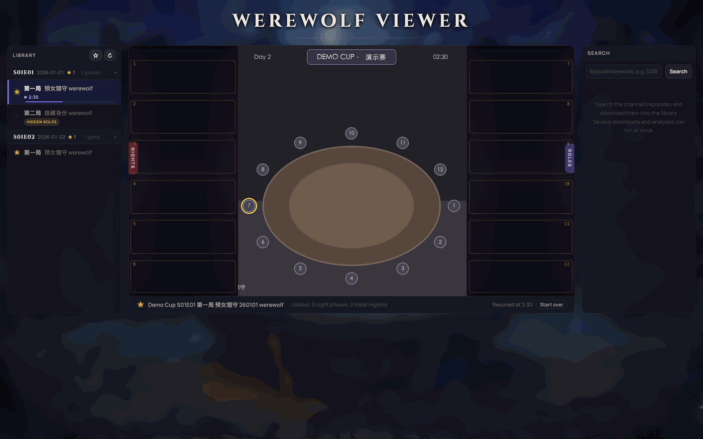
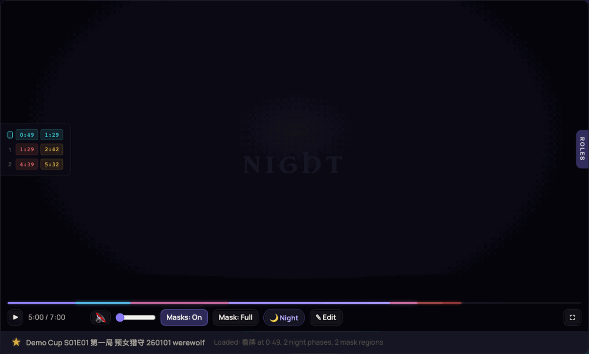
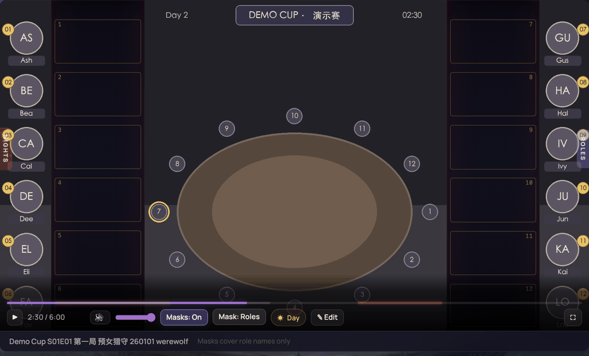
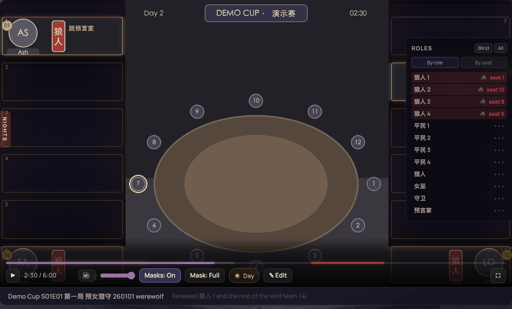
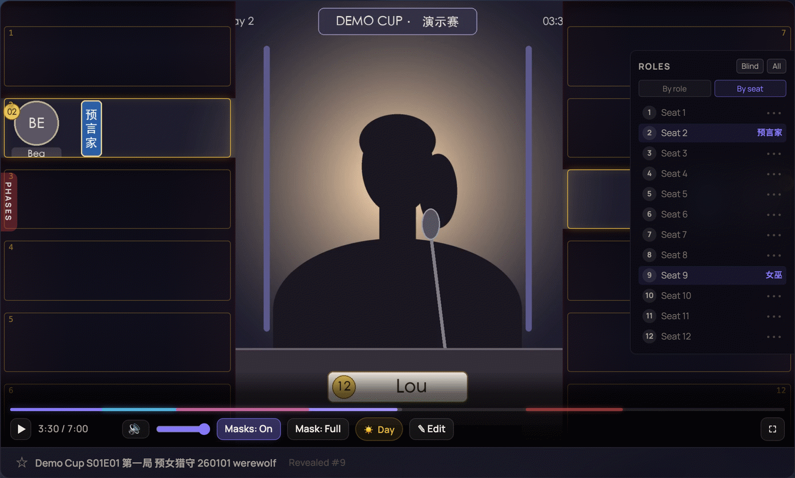
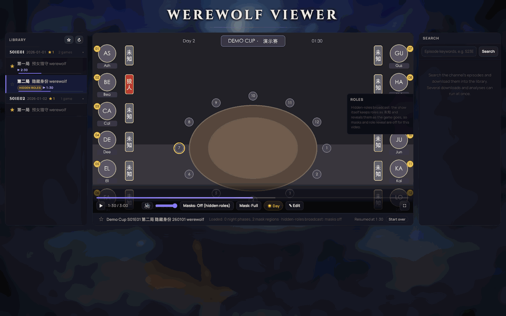
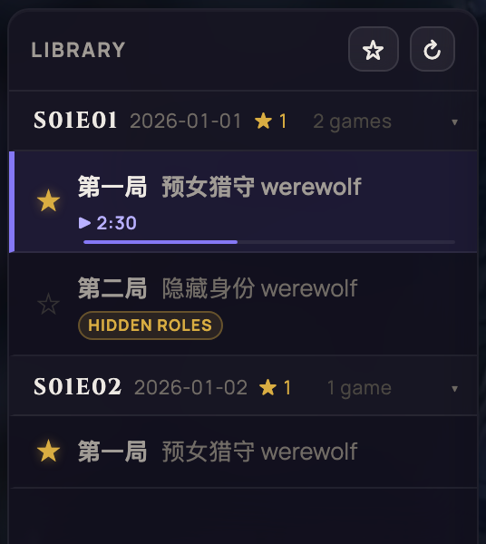
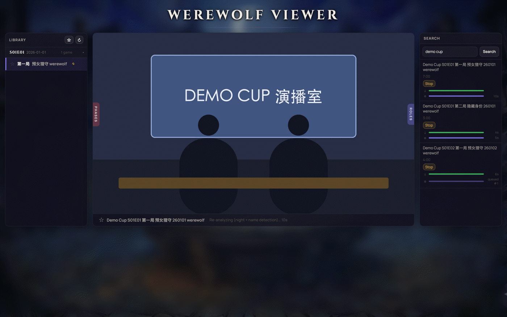
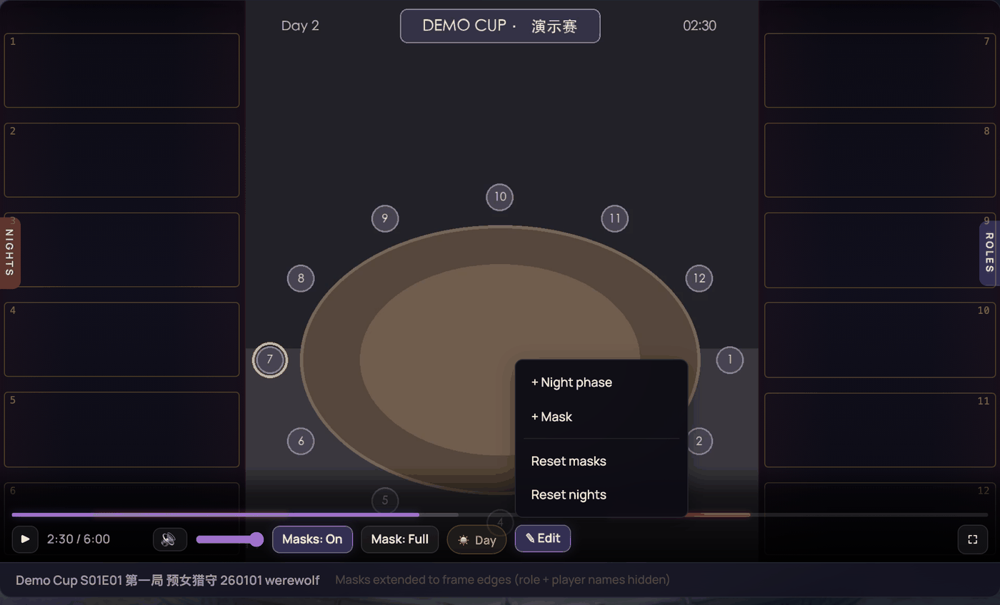

# Werewolf Viewer

A spoiler-free player for recorded 12-player werewolf (狼人杀) tournament broadcasts. It finds the card viewing, the night phases and the on-screen role labels by itself, blacks out the nights, covers the roles, and lets you reveal exactly as much as the player you want to watch as would know.



> Every screenshot in this README comes from the built-in **demo mode**, which renders made-up games with invented players. No tournament footage is included.

## Why

Tournament broadcasts show each player's role in a sidebar the whole time, and the night segments show who the wolves pick. Watching a recording as if you were at the table means hiding both, and then peeking at the one role you chose to play. That is what this viewer does, automatically, for a whole library of games.

## Features

### Nights go dark on their own

The analysis samples the video every two seconds and reads the red ambient light the studio uses at night. The nights it finds become a black overlay with muted audio, red markers on the progress bar, and a **PHASES** panel on the left edge that jumps to the start or end of the card viewing or of any night. `N` and `Shift+N` skip between nights.



### The card viewing (看牌) is marked

Before the first night the broadcast tours the twelve seats while each player looks at their role card. Nothing on screen labels it, so the analysis recognises the tour by its camera work: forty-odd seconds of seat close-ups joined by fast pans, between the still commentators' shot and the table at nightfall. It works for open and hidden-roles broadcasts alike, and finds both deals when a game is restarted. The tour shows as a teal segment on the progress bar and as the first row of the PHASES panel, so you can skip the pre-game and start right where the cards are dealt.

The card viewing also anchors the first night, which begins the moment it ends. The first night's overlay starts exactly there, and a first night the red light did not reveal is still found: a studio that never switched the red light on gets a night that lasts until the player sidebar returns.

### Roles are covered, seat by seat

OCR locates the vertical role labels in the sidebar. Each side gets an opaque mask that covers the role column and the director's running notes next to it, drawn with one thin gold **wire frame per seat** so you can still see the table layout. The masks appear once the card viewing or the first night ends (nothing to hide before that) and stay off during nights.

Two coverages are available from the controls bar:

| `Mask: Full` (default) | `Mask: Roles` |
|---|---|
| Extends to the frame edge, hiding avatars and player names as well | Covers only the role column and the notes next to it |



### Reveal exactly what one player would know

Hover the **ROLES** tab on the right edge. Everything starts blind.

- **By role** lists the roles in play with no seats shown. Clones are numbered (平民 1 … 4) in a random order fixed per game, so picking "平民 2" tells you nothing until you reveal it. Once revealed, the row says which seat that was.
- **By seat** lists seats 1 to 12. Click one to open its mask.
- **Wolves reveal what they know.** Picking a pack wolf (狼人, 狼王, 狼术师, 诡术师 …) opens every pack wolf's row at once, the way they meet on the first night. Lone wolves that never meet the pack (机械狼, 假面, 盗宝大师, 九尾) reveal only themselves, and the pack never shows them. Wolf-side comes from the ribbon colour the broadcast paints behind each label; the kind comes from the role.
- `Blind` and `All` reset either way. Your choices persist per game in the browser.





Each opening is cut strictly to that player's own label, with a guard so a neighbour's coloured ribbon tip never shows.

### Hidden-roles broadcasts are recognised

Some games are broadcast with roles shown as 未知 until the show reveals them. The analysis detects this from the sidebar, flags the game in the library, starts it with masks off, and explains in the role panel why there is nothing to reveal. Such a game gets no night phases either: the show keeps you blind itself, so there is nothing to black out, and the commentary over its nights stays audible.



### Bookmarks and resume points

Star any game in the library to keep it at hand, whether you are about to watch it or are halfway through. Episode headers count their starred games, even when collapsed, and the ☆ button above the list narrows it to bookmarked games only. The open game has its own star in the info bar, and `B` toggles it.

The viewer also remembers where you stopped. A game you were watching shows its resume time and a thin progress line in the library, reopens at that point with a *Start over* option, and is the game the app opens when you come back; with nothing in progress, the app opens your first starred game. Games watched to the end are marked watched and start from the beginning. Bookmarks and resume points are stored by the server, so they follow you from the laptop to the phone.



### A library that fills itself

Search the channel from the right-hand panel and press **Download**. Each row has its own Download/Stop button and progress bars, several jobs run at once, and the rest queue behind the slot limits (3 downloads, 2 analyses by default). The library groups games by episode; each row has **↻** to re-run the analysis and **×** to delete.



### Everything is editable

Dragging a night boundary, resizing a mask from its inner edge, or using **✎ Edit** (add a night phase at the current time, add a mask, reset either) saves to the game's metadata immediately. The detected values are kept, so **Reset** always returns to them.

A tab that has been open for a while can't overwrite newer data. If the game changed after the page loaded it (re-analysed, or edited in another tab or on another device), the save is refused, and the page loads the current version and asks you to redo the edit.



### Keyboard

| Key | Action |
|---|---|
| `Space` | Play / pause |
| `←` `→` | Seek 5 s |
| `M` | Toggle masks |
| `N` / `Shift+N` | Next / previous night |
| `F` | Fullscreen (masks follow the letterboxed video) |
| `B` | Bookmark the open game |

## How it works

**Card viewing** (`processing/analyze_cards.py`). The same 2 s scan also measures how much a small thumbnail changes over a quarter second. Stretches where the camera keeps moving are re-scanned at 0.5 s, split into shots, and grown to the long still shot on each side; a stretch counts as the seat tour when it lasts 25-80 s and enough of it is pans or cuts (a slower tour qualifies when the red night light follows within 30 s). A short table shot at nightfall is trimmed off, and a later tour counts only as a re-deal, before the first day. Checked against all 31 tours in 28 hand-verified games from three seasons, open and hidden roles: every tour found, no false ones.

**Night detection** (`processing/analyze_night.py`). Three threads scan the bottom corners of a frame every 2 s and compute the red-to-green ratio; red studio light reads 2.5 and above, daylight about 1.1. Red clusters are merged into nights by three rules: both gap boundaries are camera cuts; the gap stays red-tinted and the camera left the table at one end (close-ups during a night; when the light goes off and on again over the table it is a short day, even one lit purple); or, for newer broadcasts that cut away for minutes at a time, no day evidence lies in the gap. Day evidence is the player sidebar being on screen, or the broadcast's own 天黑请闭眼 / 天亮请睁眼 banners, found by OCR only inside candidate gaps. Boundaries are then refined at 0.25 s. No night starts before the card viewing ends (pre-game lighting and the red tablecloth in the tour's close-ups used to start some first nights early): the first night starts exactly where the card viewing ends, and one the red light missed is filled in from there to the first sighting of the sidebar. The detector is validated against 19 hand-verified games (0 false positives, 0 misses) plus the first nights of 9 more.

**Role map** (`processing/analyze_names.py`). PaddleOCR (PP-OCRv6 medium) reads the left and right 30% of a few frames and keeps the vertical boxes in the role column: known role names, misreads snapped to the nearest name, annotated labels such as 机械通灵 mapped to 机械狼, and labels the list does not know yet kept as read when every frame agrees on them. Rows are clustered, seat numbers come from the number badges and the fixed row pitch, and every seat gets a reveal band from a 6-row layout fitted to the rows that were read, so seat reveal works even where a label was not recognised. The ribbon colour behind each label gives the faction. Only seat numbers identify players; names are never extracted.

**Jobs** (`web/vite.config.js`). The dev server's middleware runs one job per game in a FIFO queue with separate download and analysis slots, and reports every job's phase, elapsed time and queue position. Downloads use yt-dlp; analysis runs night and role detection in parallel processes.

## Requirements

**Platform.** macOS 11 or later on Apple Silicon, or 64-bit Linux on an x86 CPU with AVX; on Windows, use WSL2. These are the systems PaddlePaddle, the OCR engine, has packages for, apart from native Windows, which this project doesn't support. Intel Macs, ARM boards such as the Raspberry Pi, and x86 chips without AVX (some Celeron, Pentium and Atom models) can't run the analysis. Development and every measurement below are on macOS; Linux should work but hasn't been tested.

**Software.** Python 3.11 to 3.13 (PaddlePaddle 3.3 has no packages for 3.14), Node.js 20+ with corepack, ffmpeg (for yt-dlp merges and the demo renderer), and a JavaScript runtime for yt-dlp's challenge solver (`brew install deno`).

**Hardware.**

| | Minimum | Recommended |
|---|---|---|
| CPU | Any of the above; fewer or slower cores just take longer | 8 cores or more: one analysis keeps 5 to 8 busy |
| Memory | 8 GB, with one analysis at a time (`WEREWOLF_MAX_ANALYSES=1`) | 16 GB: an analysis peaks near 3 GB, two at once near 6 GB |
| Disk | 1.5 GB for the Python environment, OCR models and web packages | Plus about 1.5 GB per hour of video (1080p60, 0.8 to 1.9 GB per hour) |
| GPU | Not needed | |

Everything runs on the CPU by default. With the CUDA build of PaddlePaddle the OCR runs on an NVIDIA GPU (untested here), but video decoding stays on the CPU. Apple GPUs are not used.

### Processing time

Measured on a Mac mini with an Apple M4 (4 performance and 6 efficiency cores, 16 GB) under macOS 26, one game at a time. A game appears in the library once its download and analysis are both done.

| Game length | Video file | Analysis |
|---|---|---|
| 45 min | 1.1 GB | 3.5 min |
| 1 h 02 min | 1.9 GB | 3.7 min |
| 1 h 20 min | 1.8 GB | 3.1 min |
| 1 h 37 min | 2.6 GB | 5.4 min |
| 2 h 28 min | 3.6 GB | 6.7 min |

- **Where the time goes.** Decoding takes about 2 minutes per hour of video: the scan reads every frame of the 1080p60 AV1 stream to sample one every 2 s. OCR checks around the night candidates add as much as 1.5 minutes more (the 1 h 20 game is a hidden-roles broadcast, with few to check). Meanwhile a separate process reads the role labels, which takes 3 to 6 minutes.
- **Two at once**, the server's default: the 1 h 02 and 1 h 37 games finished side by side in 7.4 and 7.9 minutes, only 1.2 minutes sooner than back to back, because one analysis already keeps most of the M4 busy. Together they peaked at 5.6 GB.
- **A slower CPU.** The analysis is CPU-bound, so its time scales with CPU speed. Restricted to its six efficiency cores (`taskpolicy -c background`), the same Mac took 7.5 minutes for the 1 h 02 game, twice as long.
- **Downloads** depend on your connection. Here (about 220 Mbit/s) the 45-minute game, 1.1 GB, took 43 s; at 50 Mbit/s it would take about 3 minutes.

To time your own machine, run `python3 processing/benchmarks/benchmark_hardware.py VIDEO_ID ...` on games you have downloaded. It analyses them through a temporary library, so their metadata is left alone, and prints the same figures; `--together` runs them side by side.

## Setup

```bash
git clone https://github.com/caizefeng/werewolf-viewer.git
cd werewolf-viewer

python3 -m venv processing/venv
source processing/venv/bin/activate
pip install -r processing/requirements.txt      # yt-dlp, PaddleOCR, OpenCV

corepack enable
cd web && pnpm install && cd ..

scripts/start.sh        # http://localhost:5173/ (LAN-reachable); scripts/stop.sh to stop
```

The server runs as two instances, so work in progress never reaches the one people are watching:

| | `scripts/start.sh prod` (default) | `scripts/start.sh dev` |
|---|---|---|
| URL | `:5173` | `:5174`, marked "dev" in the header |
| Code | `.prod/`, a git worktree pinned to a commit | this working tree, hot-reloading |
| Library | `videos/` | `videos-dev/` (`scripts/dev-library.sh ID...` hard-links games in) |

`scripts/deploy.sh [REF]` moves production to a commit (default `HEAD`). It refuses while a production download or analysis is running.

OCR models (about 130 MB) download into `processing/models/` on first use.

The command line does the same work as the UI:

```bash
python3 processing/download.py --video-id="VIDEO_ID"     # quote IDs that start with a dash
python3 processing/analyze.py --video-id="VIDEO_ID"      # writes videos/VIDEO_ID/metadata.json
python3 processing/analyze.py --video-id="VIDEO_ID" --keep-edits   # re-analyse, keep edited nights / masks
python3 processing/update_role_maps.py [VIDEO_ID ...]    # re-scan roles only, keeps manual edits
```

### Environment variables

| Variable | Default | Meaning |
|---|---|---|
| `WEREWOLF_MAX_DOWNLOADS` | 3 | Concurrent downloads |
| `WEREWOLF_MAX_ANALYSES` | 2 | Concurrent analyses (each keeps 5 to 8 cores busy and peaks near 3 GB) |
| `WEREWOLF_VIDEOS_DIR` | `videos/` | Where games are stored |
| `WEREWOLF_DEMO` | unset | Serve the rendered demo games instead of YouTube |

The YouTube channel searched by default is set by `CHANNEL_URL` in `web/vite.config.js`.

### Demo mode

To try the viewer without downloading anything, render the synthetic games and run a server against a scratch library. The games look like a broadcast's speaking shot: the player who has the floor is a simple backlit person icon at a desk with a seat name plate, and the role sidebar runs down both sides.

```bash
source processing/venv/bin/activate
python3 processing/demo/make_demo_video.py          # three games into processing/demo/library/
cd web && WEREWOLF_DEMO=1 WEREWOLF_VIDEOS_DIR=/tmp/demo-library pnpm exec vite --port 5174
```

Search for `demo cup`, download the three games, and the real pipeline analyses them. The screenshots above are taken the same way, by a script:

```bash
python3 tests/e2e/readme_screenshots.py              # retake docs/screenshots/ on the demo games
python3 tests/e2e/readme_screenshots.py reveal-role  # just one
```

## Tests

Browser end-to-end tests drive the real UI with Playwright against a throwaway server on a copy of the demo library, so they never touch your own games:

```bash
pip install -r tests/requirements.txt && playwright install chromium   # once, in processing/venv
python3 tests/e2e/run.py              # player regression walk + bookmarks/resume suite
python3 tests/e2e/run.py bookmarks    # one suite
python3 tests/e2e/run.py --fresh      # re-analyse the demo games first (after pipeline changes)
```

## Project structure

```
werewolf-viewer/
├── processing/
│   ├── analyze.py              # pipeline: night + role detection in parallel, writes metadata.json
│   ├── analyze_night.py        # night phases (corner redness, cut/ratio/evidence merging, refinement)
│   ├── analyze_cards.py        # card viewing (看牌): the seat tour, from camera motion
│   ├── analyze_names.py        # role map and masks (PaddleOCR), banner and sidebar checks
│   ├── update_role_maps.py     # re-scan roles only, preserving manual edits
│   ├── download.py             # yt-dlp download with client fallbacks
│   ├── demo/                   # synthetic game renderer + demo download stand-in
│   └── benchmarks/             # ground-truth validation, hardware timing
├── web/
│   ├── vite.config.js          # dev server: API, job queue, file serving
│   └── src/                    # main.js (library, search, jobs), player.js (player, masks, reveal), style.css
├── scripts/                    # start.sh / stop.sh [prod|dev], deploy.sh, dev-library.sh
├── tests/e2e/                  # browser end-to-end tests (demo library, Playwright)
├── docs/screenshots/           # README images (demo games)
├── videos/                     # downloaded games + metadata (gitignored)
└── videos-dev/                 # the dev instance's library (gitignored)
```

## API

| Method | Endpoint | Description |
|---|---|---|
| GET | `/api/videos` | Analysed games, with `hiddenRoles` and each game's bookmark and resume point |
| GET | `/api/downloaded` | Every game directory with `hasVideo` / `hasMetadata` |
| POST | `/api/search` | Search the channel, body `{query}` |
| POST | `/api/download` | Queue download + analysis, body `{videoId}` |
| POST | `/api/analyze` | Queue a re-analysis of a downloaded game, body `{videoId}` |
| GET | `/api/job-status` | Every job: phase, elapsed time, timings, queue position |
| POST | `/api/stop` | Stop one job, body `{videoId}` |
| POST | `/api/delete` | Delete a game, body `{videoId}` (refused while its job runs) |
| POST | `/api/metadata` | Save edited night phases and masks, body `{videoId, version, night_phases, name_masks}`; `version` is the `X-Metadata-Version` header the page loaded metadata.json with, and a stale one gets 409 |
| POST | `/api/state` | Save a game's bookmark and resume point, body `{videoId, bookmarked?, position?, duration?}` |

## Tuning

Night detection constants live at the top of `processing/analyze_night.py`:

| Constant | Default | Meaning |
|---|---|---|
| `RED_THRESH` | 2.5 | Corner R/G ratio that counts as red light |
| `CUT_THRESH` | 40 | Frame difference that counts as a camera cut |
| `MAX_MERGE_GAP` | 100 s | Longest gap bridged on red-tint evidence |
| `MAX_CUT_MERGE_GAP` | 180 s | Longest gap bridged when both boundaries are cuts |
| `MAX_EVIDENCE_GAP` | 240 s | Longest gap bridged on day-evidence grounds (120 s without banners) |
| `MIN_PHASE_DURATION` | 35 s | Shorter red stretches are ignored |
| `ENTRY_BUFFER` / `EXIT_BUFFER` | 2 s / 1 s | Overlay lead before red-on and lag after red-off |

Card-viewing thresholds (`CARD_*`: tour length, pan and motion shares, re-deal window) are at the top of `processing/analyze_cards.py`. Reveal band geometry is `BAND_PAD` and `BAND_GUARD` in `web/src/player.js`.

## License

[MIT](LICENSE)
